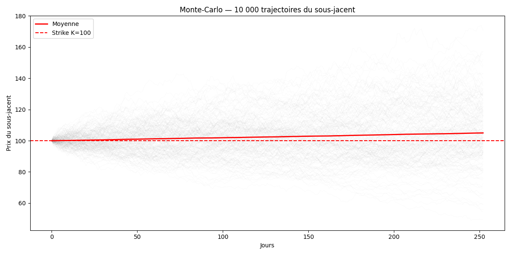
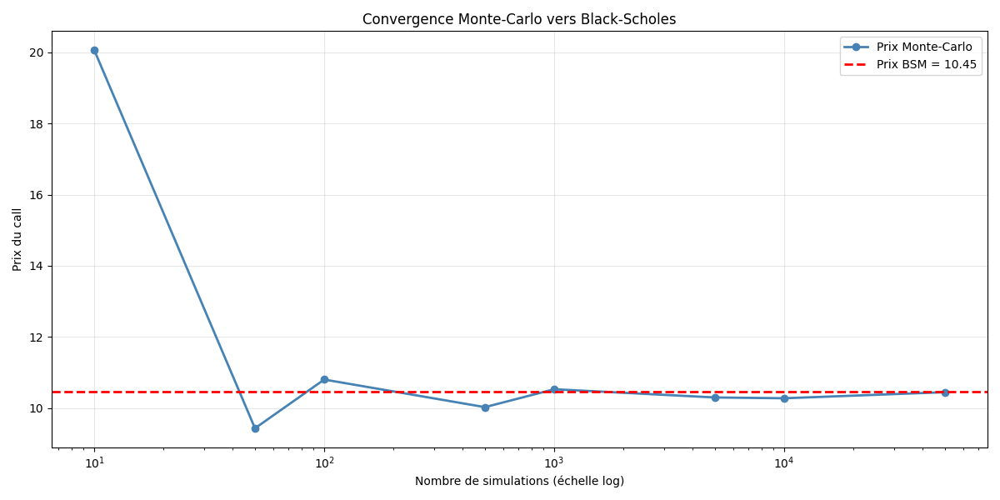
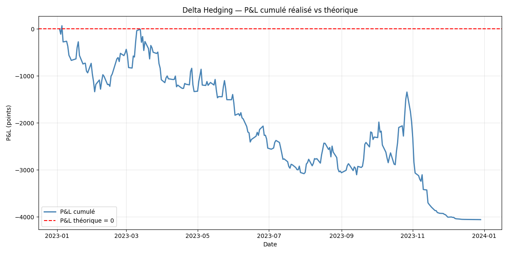
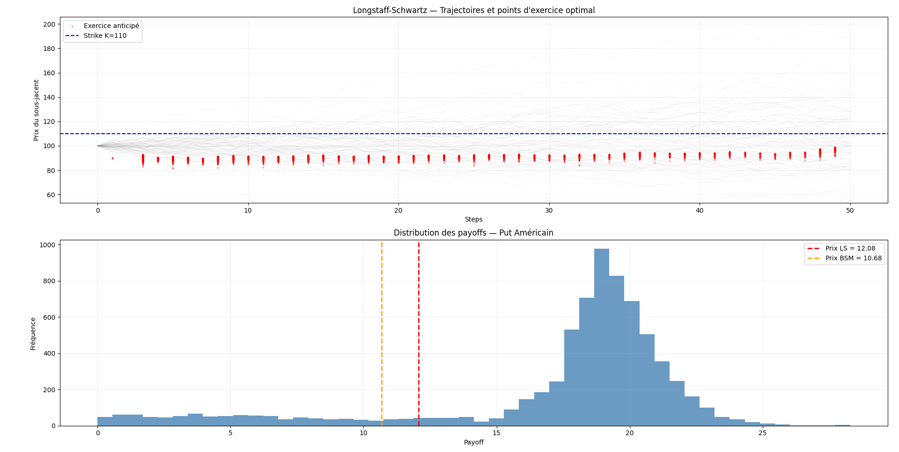

A VBA/Excel version of the pricer is available: see [README Black Scholes VBA](README%20Black%20Scholes%20VBA.md).

# Derivatives Pricer — Python

Black-Scholes pricing, Greeks, Monte-Carlo simulation, delta-hedging backtest on real S&P 500 data, American option pricing via Longstaff-Schwartz, and a Monte Carlo autocall pricer.

Built as part of an independent quantitative finance self-study programme alongside the DerivativesFinance training platform and *Options, Futures & Other Derivatives* (J.C. Hull).

---

## Projects

### 1. Black-Scholes Pricer (`Black scholes.py`)

Full implementation of the Black-Scholes-Merton model for European options.

**Pricing**
- Vanilla call & put using closed-form BSM formula

**Greeks — first order**
| Greek | Formula |
|-------|---------|
| Delta | N(d1) |
| Gamma | N'(d1) / (S·σ·√T) |
| Vega  | S·N'(d1)·√T / 100 |
| Theta | -(S·N'(d1)·σ)/(2√T) - rKe^(-rT)·N(d2) |
| Rho   | K·T·e^(-rT)·N(d2) / 100 |

**Greeks — second order**
| Greek | Description |
|-------|-------------|
| Vanna | Sensitivity of Delta to volatility — key for exotic hedging |
| Volga | Sensitivity of Vega to volatility (Vega convexity) — drives exotic pricing |

**Monte-Carlo simulation**
- 10,000 simulated paths of the underlying
- European option pricing via discounted average payoff
- Convergence analysis: MC price vs closed-form BSM across 10 to 50,000 simulations

---

### 2. Delta-Hedging Backtest (`hedging.py`)

Dynamic delta-hedging simulation on real S&P 500 data (2023).

**Methodology**
- Download 250 days of S&P 500 prices via `yfinance`
- Compute BSM delta at each trading day
- Simulate daily portfolio rebalancing: sell call, buy delta shares, earn risk-free rate on cash
- Track cumulative P&L vs theoretical P&L = 0

**Key result**
The backtest demonstrates that discrete daily rebalancing generates a non-zero P&L due to:
- Basis risk between implied volatility (σ = 20%) and realised volatility
- Unhedged gamma exposure between rebalancing dates

---

### 3. Longstaff-Schwartz — American Put Pricer (`longstaff_schwartz.py`)

Pricing of American put options via Monte-Carlo simulation and least-squares regression.

**Methodology**
- Simulate 10,000 paths of the underlying (GBM) across 50 exercise dates
- Backward induction from maturity to t=0
- Least-squares regression (degree 2) to estimate continuation value at each exercise date
- Optimal exercise rule: exercise if immediate payoff > continuation value

**Key results**
- American put (Longstaff-Schwartz) : 12.08
- European put (BSM benchmark)      : 10.68
- Early exercise premium             : +1.40 (+13%)

**Visualisation**
- Simulated paths with optimal early exercise points
- Payoff distribution — American vs European benchmark

---

### 4. Autocall Pricer (`autocall.py`)

Monte Carlo pricer for a Phoenix Autocall structured product (without coupon memory).

### Context
A Phoenix Autocall pays a conditional coupon as long as the underlying stays above a
coupon barrier, and is automatically redeemed early (called) if the underlying is above
a call barrier on an observation date. In case of a significant decline at maturity
(below the protection barrier), capital is no longer guaranteed.

### Product structure
At each observation date:
- **Coupon test**: if S >= coupon barrier -> coupon paid on that date (a missed coupon is not recovered)
- **Call test**: if S >= call barrier -> early redemption (notional returned, product stops)

At maturity, if never called:
- S_T >= protection barrier -> capital returned at 100%
- S_T <  protection barrier -> capital loss proportional to the decline (S_T / S0)

### Methodology
- Monte Carlo simulation under the risk-neutral measure (GBM)
- Exact discretization of the GBM (no discretization bias)
- Variance reduction via antithetic variates
- Cash-flow-by-cash-flow discounting: each coupon is discounted from its own payment date,
  and the notional from its redemption date (early call or maturity)

This product is path-dependent (early call, barrier tests at each date), so no closed-form
formula exists for it, hence the choice of Monte Carlo.

### Assumptions
Constant volatility and risk-free rate, no dividends (q = 0), no volatility skew
(Black-Scholes model).

### Key results
With S0=100, r=3%, vol=20%, T=3 years, 12 quarterly observation dates, call barrier 100%,
coupon barrier 70%, protection barrier 60%, 100,000 simulated paths:

**Price = 101.95% of notional (95% CI ≈ ±0.06%)**

Coupon sensitivity (the price increases with the coupon offered):

| Quarterly coupon | Price   |
|------------------|---------|
| 1%               | 98.85%  |
| 2%               | 101.95% |
| 3%               | 105.05% |
| 4%               | 108.15% |

### Validation
With vol -> 0, the underlying follows its forward and is called at the first observation:
the price converges to (1 + coupon) x exp(-r x 0.25), e.g. 101.24% for a 2% coupon.

### Possible improvements
- Coupon memory effect (Phoenix with memory)
- Greeks (Delta, Vega) via finite differences
- Step-down call barrier
- Comparison with an Athena autocall (coupon accrued and paid only at redemption)
- Solver for the coupon that makes the product worth par (100%)

## Author

Djibril DRAME — M1 Grande École, Grenoble Ecole de Management
